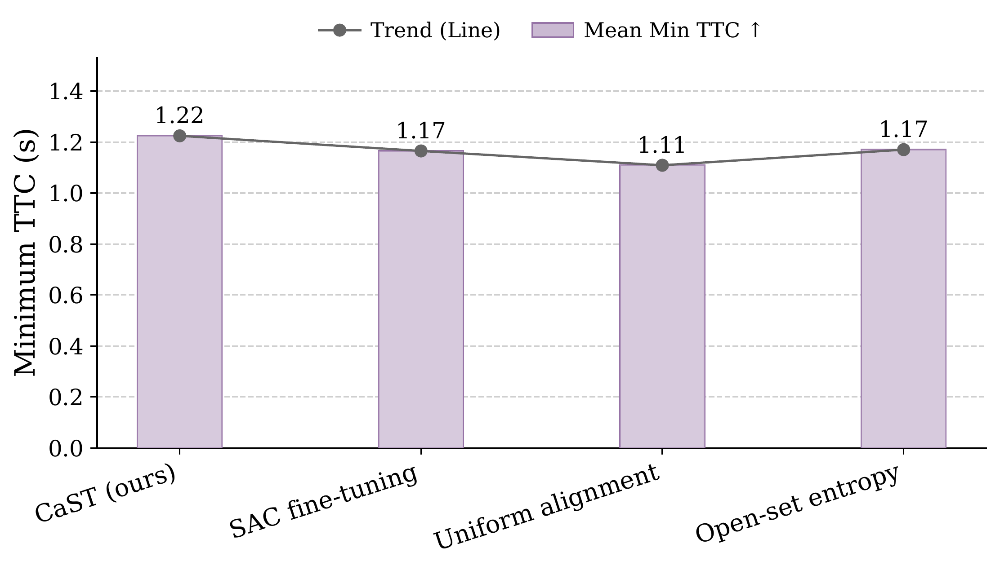
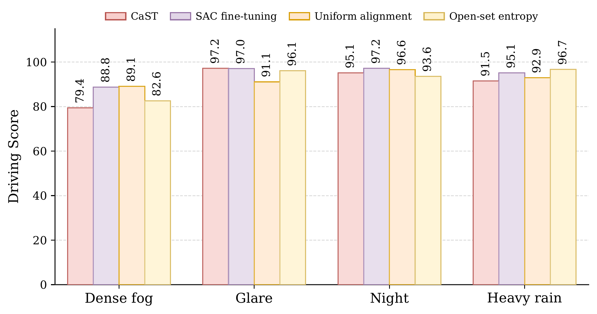
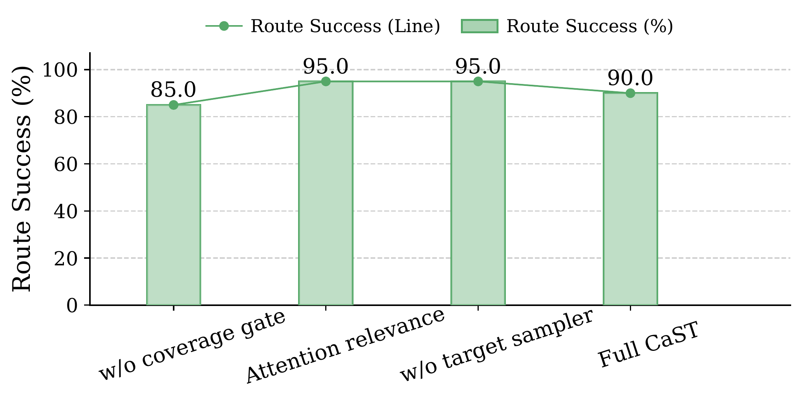
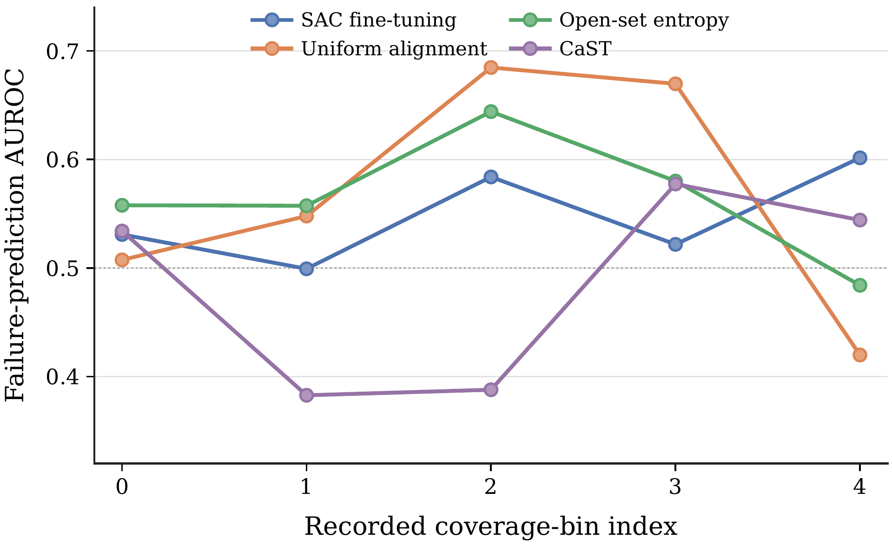
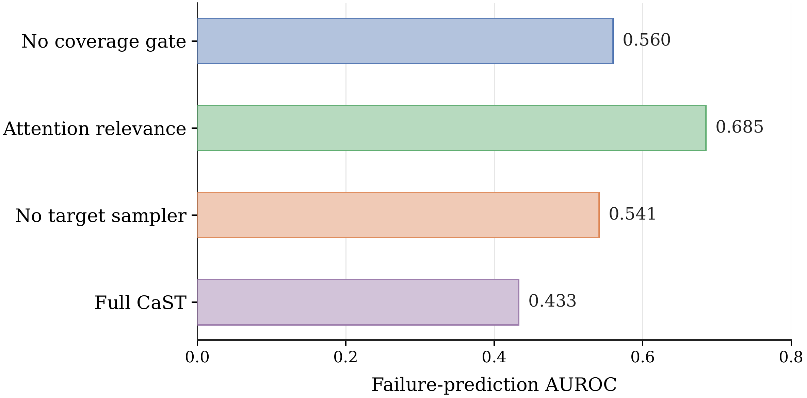
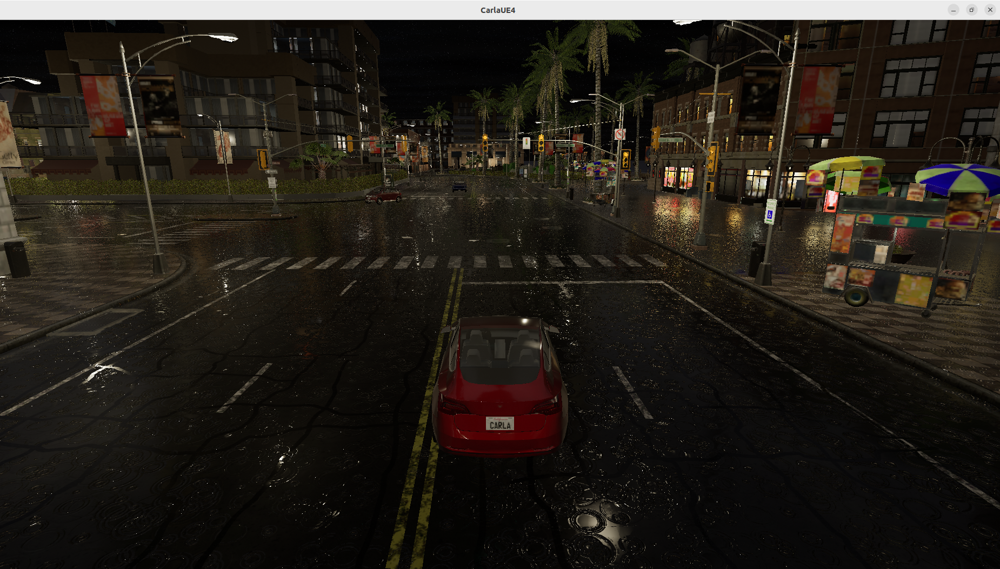
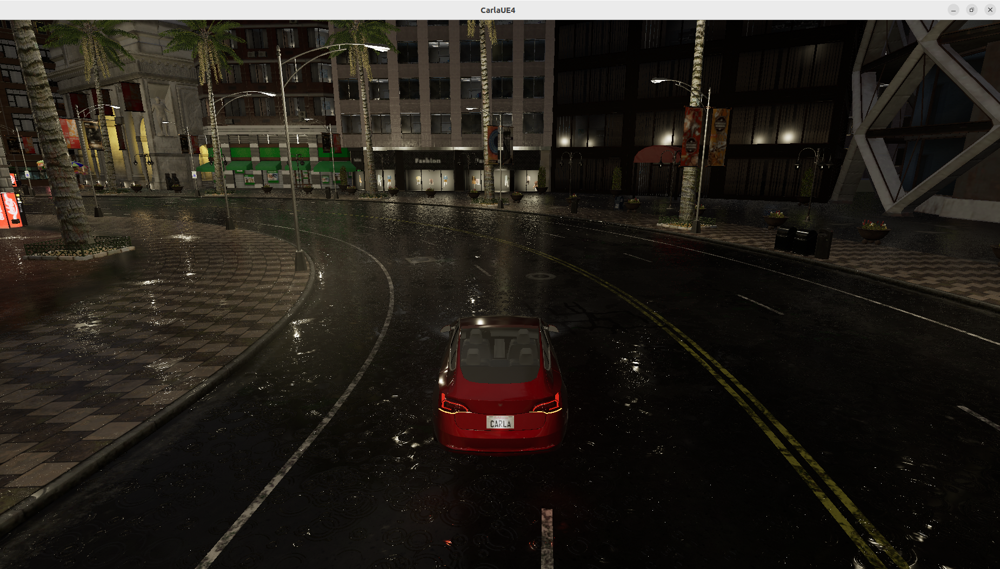
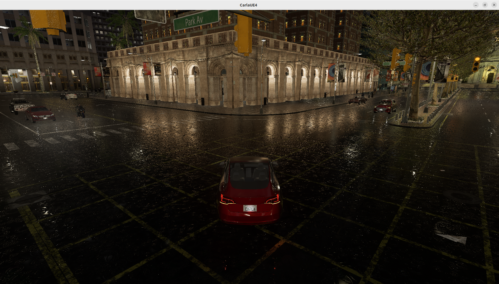
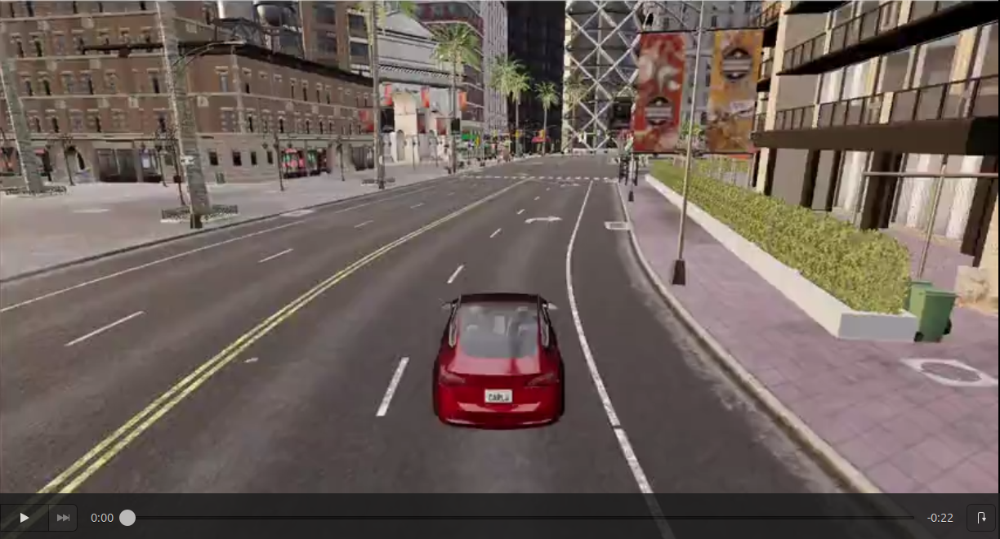

# Transfer What Is Caused and Covered: Policy Transfer for Safe End-to-End Driving

**Causal-Support Transfer (CaST)** · CARLA 0.9.15 · PyTorch · RGB-D · Soft Actor-Critic (SAC)

CaST adapts a driving policy across appearance and road-layout shifts by separating **causal relevance** from **source coverage**. Each interaction is assigned an estimated effect `ĉᵢ` and a support rank `ρᵢ`. The pair determines whether to preserve source behavior, retain uncertainty, or reduce dependence on an irrelevant cue. Target episodes are selected using uncovered causal mass.


## Core idea


| Interaction | Condition | Adaptation behavior |
|:--|:--|:--|
| Causal + covered | `ĉᵢ ≥ τc`, `ρᵢ ≥ τρ` | Source-guided alignment |
| Causal + uncovered | `ĉᵢ ≥ τc`, `ρᵢ < τρ` | Preserve a coverage-dependent uncertainty floor |
| Low causal effect | `ĉᵢ < τc` | Penalize action sensitivity to the interaction |

The released code uses a smooth gate and a separate floor:

```python
beta = (rho / tau_rho - 1.0).clamp(0.0, 1.0)  # alignment gate
ell  = (1.0 - rho / tau_rho).clamp(0.0, 1.0)  # uncertainty floor
omega = causal_score * beta                     # supported causal weight
```

Here `ρ` is a rank of the k-nearest-neighbor distance in the **frozen source embedding space**; it is not a calibrated probability that the policy will succeed.

## Code tour

The implementation has two entry points: [`code/car.py`](code/car.py) trains perception, source policies, and adapted policies; [`code/car_eval.py`](code/car_eval.py) evaluates **frozen** checkpoints. The tour below names the actual classes and functions in the released code. Snippets are shortened for readability; follow the links for the complete implementations.

### 1. Execution path: from CLI to a target policy

```text
car.py: main() → supervisor_main() → worker_main()
  ├─ parse_args() / setup_run() / build_suites()
  ├─ run_perception_stage() → run_rgbd_perception_stage()   [RGB-D mode]
  ├─ run_source_stage() → train_episode() → CaSTAgent.update()
  └─ adapt_all() → run_adaptation()
        ├─ SourceArtifacts → make_run_agent()
        ├─ TemplateSampler → Conditions(town, weather, traffic, ...)
        ├─ train_episode() → replay + online optimizer steps
        ├─ causal-head updates + accepted coverage-bank points
        └─ ckpt/ → agent.pt + adapt.json + ADAPT_DONE

car_eval.py: main()
  ├─ legacy suite mode → evaluate_town() → evaluate_suite()
  │    → eval_A__Town03.json / eval_L__Town01.json / ...
  ├─ pilot mode → evaluate_pilot_town() → drive_pilot_episode()
  │    → <eval-tag>/<town>/<policy>.json
  └─ merge_results() / aggregate_main() → results/*.csv
```

`supervisor_main()` isolates the training worker from CARLA server failures. A map switch is requested via `TownSwitch` and a saved `town_request.json`; when `--carla-cmd` is supplied, the supervisor restarts CARLA in the next town. Training resumes from persisted state rather than restarting the adaptation budget.

### 2. CARLA observations: `CameraRig` → `CaSTCarlaEnv`

**Sensor assembly.** `CameraRig` attaches six synchronized RGB cameras and, in RGB-D mode, six depth cameras. Sensor callbacks copy the incoming frames; `get()` matches a simulator frame. In `CaSTCarlaEnv`, `_grab_images()`, `_rgbd_entity_features()`, and `_collect_entity_features()` convert those frames into the policy observation. `SegNet`, `TokenTracker`, `rgbd_detect()`, and `rgbd_boxes()` implement the RGB-D detection/tracking path. `BEVDetector` implements the separate camera-only path with lifted BEV features, object heads, and a pooled scene descriptor. `--perception gt` is a distinct noisy-privileged-observation mode, **not** the reported RGB-D setting.

**Observation interface.** `CaSTCarlaEnv._get_obs()` returns a dictionary with the following keys:

| Tensor | Role |
|:--|:--|
| `scalars` | Ego motion, prior controls, route geometry, and related route features (`x₀`) |
| `edges` | Up to `max_entity_obs=10` relational entity tokens (`x₁:ₙ`) |
| `mask` | Valid/padded token indicator; padded slots must be ignored |
| `scene` | Pooled scene descriptor `b(s)` for scene-level support |

`_build_tokens()` encodes a detected entity with relative position `(x,y)`, relative velocity `(vx,vy)`, a four-way semantic vector, task-specific route/light fields, and detection variance. The current implementation adds route-relative lateral position and arc length; a traffic-light token carries signal information. `_route_relative()` projects detections into the route frame, not just the vehicle frame. `_map_light_token()` and `_camera_colour_of_light()` handle the governing traffic-light representation.

```python
# Schematic of the real observation path, not a standalone API.
obs = env._get_obs()                   # {'scalars', 'edges', 'mask', 'scene'}
sc, ed, valid, scene = CaSTAgent.obs_tensors(obs, device)
# sc: [B, scalar_dim]       ed: [B, N, edge_dim]
# valid: [B, N]             scene: [B, scene_dim]
```

**Control interface matters.** `CaSTActor` outputs two bounded variables, `[longitudinal, steer]`. `policy_to_env()` converts them to `[throttle, brake, steer]` by splitting the sign of longitudinal command. Under the archived B20 setting, `--lateral-control controller` uses route-guided steering while the policy decides longitudinal behavior; `--light-source v2i` supplies map-associated broadcast signal state. These assisted interfaces must be disclosed and matched at evaluation. `--lateral-control policy` and `--light-source map_camera` are different protocols.

### 3. Relational encoder and policy: `RelationalEncoder`, `CaSTActor`, `CaSTCritic`

`RelationalEncoder.attention()` scores each visible token from the ego state and token features, then penalizes distance and reported detection variance:

```python
logits = a_psi(concat(x0, xi)) - lam_d * ||p_i||² - lam_s * sigma_i²
w = softmax(logits masked to valid tokens)
h_i = W_theta(x_i)
z = sum_i(w_i * h_i)
```

`pooled()` returns `(z, w, h)`, and `forward()` combines pooled interactions with encoded ego scalars. The encoder can use a linear or MLP token projection; the MLP branch also includes max-pooled token features to retain strong local hazards. `match_token_encoder()` checks the projection architecture encoded in older checkpoint keys before loading a saved policy.

`CaSTActor.dist_params()` predicts action means and bounded log standard deviations. It masks previous-action scalar slots before the actor encoder to reduce action-copying shortcuts. `sample()` draws from a Gaussian and applies `tanh`; deterministic evaluation uses its mean. `motion_head(h, edges)` predicts the next relative displacement and log variance of each token. Each `CaSTCritic` receives an encoded state and the action; `CaSTAgent` maintains a critic ensemble and corresponding target critics.

```python
mu, log_std, w, h = actor.dist_params(sc, ed, mask)
a, logp, *_ = actor.sample(sc, ed, mask, deterministic=False)
motion_mu, motion_logvar = actor.motion_head(h, ed)
q_all = agent.critic_stack(sc, ed, mask, a)  # [K, B]
```

### 4. Intervention labels: `entity_effects` → `NullBank` → `CausalHead`

The causal labeler evaluates a **privileged scene representation** (`PrivScene`) rather than inferring causality from attention. `expert_action()` supplies the reference decision; `rollout_margin()` scores a fixed ego-action sequence. `apply_op()` perturbs one entity at a time: removal, freezing, velocity shift, or signal-state switch (depending on entity type). `entity_effects()` compares the reference decision and margin with their altered-scene counterparts.

```python
# Simplified logic from entity_effects(); equations omitted intentionally.
base_action = expert_action(scene, scene.entities, cfg)
base_margin = rollout_margin(scene, scene.entities, actions, cfg)
for op in PHYSICAL_OPS[entity.kind]:
    edited_entities = apply_op(scene.entities, entity_idx, op)
    effect = abs(base_action - expert_action(scene, edited_entities, cfg)).sum()
    effect += abs(base_margin - rollout_margin(scene, edited_entities, actions, cfg))
```

`null_probe_effects()` creates off-road reference probes; `NullBank` stores their effects in distance bins and computes a rank-based target `cᵢ`. `CausalDataset` stores inputs and effects; `CaSTAgent.train_causal_head()` fits `CausalHead(x₀,xᵢ) → ĉᵢ ∈ [0,1]` by MSE. `Labeler` schedules causal labeling during training. **Interpretation:** the privileged perturbation/margin code is not evidence that every label was obtained by resetting and replaying a separate CARLA world; direct physical-intervention validation requires its own records.

### 5. Source coverage: `SourceArtifacts`, `KNNBank`, `CoverageModel`

`SourceArtifacts` loads the frozen source actor, source replay snapshot, causal dataset, and null bank. `banks(spec)` projects source replay tokens through the source encoder, selects high-effect interactions when `causal_mask=True`, and builds an interaction bank `Zₛ` and scene bank `Bₛ`. Separate source held-out distances provide reference distributions. `CoverageModel.kdist_source()` queries k-nearest neighbors; `rank()` converts the k-th distance into source-relative coverage `ρ`.

```python
source_h = agent.h_source(edges)             # frozen W_S for CaST
source_knn = agent.cov.kdist_source(source_h)
rho = agent.cov.rank(source_knn[..., -1])   # high => closer to source reference
beta = clamp(rho / tau_rho - 1, 0, 1)
ell  = clamp(1 - rho / tau_rho, 0, 1)
```

`CaSTAgent.coverage_terms()` returns `rho`, `rho_t`, `beta`, `ell_t`, `rho0`, and `ell0_t`. The unmodified **source** rank gates alignment; the merged bank (`Zₛ` plus approved target points) adjusts the **target** uncertainty floor. `CoverageModel.clone()` gives each adaptation run independent growth while sharing the immutable source reference.

For the archived CaST specification, `RunSpec.q=0.05` gives `τc=1−q` and `τρ=q`. Once `ρ≥2τρ`, the smooth alignment gate is saturated. Coverage rank is an empirical distance statistic, **not a probability that the policy's action is correct**.

### 6. Uncertainty and action selection: `CaSTAgent.ubar()`

The uncertainty path uses motion variance, support floors, and critic disagreement. Token uncertainty starts from predicted motion variance and retains a floor on unsupported interactions. The scalar score `ū` pools tokens with attention weights, adds a calibrated critic-disagreement channel and optionally a scene-level floor. `step_quantities()` exposes diagnostics for evaluation and logging.

```python
u_i = 1 - (1 - ell_i) * exp(-motion_var_i / sig_ref)  # CaST two-channel path
u_bar = sum_i(w_i * u_i) + critic_disagreement_term + scene_floor
if cfg.uncertainty_fusion == 'mean':
    u_bar /= active_channel_count
u_bar = clamp(u_bar, 0, 1)
alpha = alpha0 * (1 - u_bar)
Q_pessimistic = mean(Q_k) - kappa * u_bar * std(Q_k)
```

This is **uncertainty-conditioned optimization**, not a certified safety constraint or calibrated collision probability. The recorded B20 setup used `--uncertainty-fusion mean`; `sum` is a different ablation. `step_quantities()` logs `ubar`, `ubar_noscene`, `ub_motion`, `ub_critic`, `ub_scene`, `rho`, `rho0`, `c_hat`, and `ell_t` when available.

### 7. SAC and transfer objectives: `CaSTAgent.update()`

`CaSTReplay` stores transitions and optional expert, motion, causal, and coverage fields. `train_episode()` computes coverage/causal diagnostics, collects a target transition, and triggers off-policy updates. The **critic** uses sampled next actions, an entropy-adjusted target, a selectable ensemble reduction (`mean`, `lcb`, `min2`), and a target upper cap; each critic receives a bootstrap mask. The **actor** combines its entropy-regularized value objective with active auxiliary terms.

| Code location | Term or behavior | When used |
|:--|:--|:--|
| `CaSTAgent.update()` | Ensemble TD loss + soft target updates | All SAC methods |
| `balanced_imitation_loss()` | Group-balanced source demonstrations | Configured source/target anchor |
| `target_state_bc_weight` | Optional privileged expert on selected target states | **Assisted setting**; report separately |
| `CaSTActor.motion_head()` | Relative-motion Gaussian NLL | Motion-supervised updates |
| `coverage_terms()` + `L_A` | `ĉᵢ βᵢ`-weighted embedding/source-policy agreement | CaST |
| `invariance_loss()` | Mask a sampled token, penalize policy change weighted by `1−ĉᵢ` | CaST when enabled |
| `ubar()` + cautious value | Support floor + uncertainty-weighted critic penalty | CaST when enabled |
| `uniform_transfer_loss()` | Source action, attention MMD, uncertainty-moment alignment | Uniform baseline |
| `alpha_of()` | Novelty-dependent entropy variant | Open-set entropy baseline |
| No extra transfer loss | Standard SAC adaptation plus configured shared anchors | SAC fine-tuning |

`invariance_loss()` samples **one valid entity token per state**, masks it, evaluates the changed policy output, and weights the difference by `1−ĉᵢ` and the token count. `policy_divergence()` selects the metric: `--align-metric action` uses squared differences of squashed actions in the B20 experiment; `--align-metric kl` is the optional Gaussian-KL form. Do not describe action-distance results as if KL were run.

```python
# Loss structure in update(); illustrative grouping rather than executable code.
L = L_SAC_actor + L_motion
L += L_source_BC                 # when configured
L += L_target_expert_BC          # only in assisted runs
if method == 'cast':
    L += lambda_A * L_alignment
    L += lambda_I * L_invariance  # when enabled
elif method == 'uniform':
    L += lambda_transfer * L_uniform
```

**Diagnostics:** `last_stats` records values including `critic_loss`, `actor_loss`, `td_abs`, `critic_spread`, `L_A`, `L_I`, `motion_nll`, `clip_frac`, and imitation errors. These are the starting point for investigating whether a transfer term dominates SAC or whether a checkpoint has collapsed to persistent braking.

### 8. Adaptation loop: `RunSpec` → `TemplateSampler` → `run_adaptation()`

`RunSpec` defines the experimental identity (`suite`, `method`, `seed`, `budget`) and ablation switches (`gate`, `scene_term`, `epistemic`, `invariance`, `validated_growth`, `relevance`, `sampler`, `q`, `k`). `run_id()` constructs stable names such as `A__cast__B20__s1__sampler-cast`.

`TemplateSampler.sample()` draws weather/traffic templates. With `sampler='cast'`, it updates template scores using episode mean unresolved causal mass `mean_U`, applies temperature-scaled sampling plus exploration, and can expand high-scoring templates with local traffic/weather variations. `run_adaptation()` handles town blocks, minimum weather coverage, per-episode learning, causal-head refits, and growth of the target support bank.

```text
for episode in 1..B:
    choose town/weather/scenario template
    train_episode(...)                 # policy acts; replay and optimizer update
    sampler.update(episode_summary)   # CaST uses mean_U
    if CaST and accepted_episode:      # no collision and margin threshold met
        append observed target embeddings to run-local coverage banks
    update causal head from collected labels
    save checkpoint + replay + sampler/RNG state
write agent.pt, adapt.json, ADAPT_DONE
```

**Implementation detail:** `run_adaptation()` accepts growth based on **the collected adaptation episode's** collision and margin checks. The standalone independent safety-validation rollout discussed in the manuscript is **not implemented in this archived path**. Treat this as an implementation limitation, not a completed validation experiment.

### 9. Checkpointing, restart, and model compatibility

Training checkpoints are resumable. `run_adaptation()` saves model state, `replay.npz`, optional causal dataset, `growth.pt`, `rng.pt`, and episode/sampler metadata in `ckpt/`; the finished run stores `agent.pt`, `adapt.json`, and `ADAPT_DONE`. `CaSTAgent.state()` also serializes critic and optimizer state, causal head, uncertainty calibrator, and revision markers. `load()` checks compatibility with the training configuration.

```text
<out-dir>/
  run_config.json
  perception/segnet.pt             # RGB-D frontend (required; not in this repo)
  source/source_agent.pt           # shared source model (required; not in this repo)
  source/source_snapshot.npz
  source/causal_dataset.npz
  source/null_bank.pt
  runs/A__cast__B20__s1__sampler-cast/
    ckpt/{agent.pt,replay.npz,state.json,rng.pt,...}
    agent.pt
    adapt.json
    ADAPT_DONE
    eval_A__Town03.json            # after matching legacy evaluation
```

The repository's [`checkpoints/`](checkpoints/) directory publishes six *final adapted CaST* `agent.pt` files, **not** the complete source/perception training workspace or baseline checkpoints. They must be paired with the original matching artifacts and observation/control flags.

### 10. Frozen evaluation and CSV aggregation: `car_eval.py`

`load_car_module()` imports the matching `car.py`. `eval_specs()` resolves the trained runs and intended suites. `load_agent()` requires `ADAPT_DONE`; `freeze()` puts model components in evaluation mode and disables parameter gradients. `evaluate_town()` runs selected method/suite/town combinations, writing restartable `eval_<suite>__<town>.partial.json` and then atomic final JSONs. `write_town_csv()` exports per-route `DS`, `RC`, `IS`, success, collisions, red-light events, distance, TTC, and CTE.

The evaluator has **two distinct protocols**:

| Mode | Entry point | Output and appropriate use |
|:--|:--|:--|
| **Legacy suite mode** (`--eval-stages ...`) | `evaluate_town()` → `car.evaluate_suite()` | Matched A/L/C evaluation used by archived B20 scripts; output `runs/<run>/eval_<suite>__<town>.json` |
| **Pilot mode** (default) | `evaluate_pilot_town()` → `drive_pilot_episode()` | A separate frozen-checkpoint town/route-seed study; output under `evaluation/<eval-tag>/...` |

Pilot metadata records hashes of checkpoints, detector and code plus route/configuration metadata; mismatched settings cannot silently reuse completed JSONs. In both modes, frozen evaluation uses deterministic policy actions with **no gradient updates**. Changing `--perception`, `--light-source`, `--lateral-control`, route definitions, or source artifacts changes the protocol.

**Result flow:** per-route JSON → `merge_results()` → aggregate tables. To check an archived CSV, confirm that the four methods use the *same* `(route, conditions)` keys for each town; count routes per method before computing paired differences. `results/paper_csv/10_result_provenance.csv` and `results/CaST_supplement_snapshot/00_file_status.csv` document the archived reporting scope.

### 11. What to inspect when debugging

| Symptom | First functions / outputs to inspect |
|:--|:--|
| Missing or unstable objects | `CameraRig.get`, `_rgbd_entity_features`, `_build_tokens`, `mask`, `slot_info` |
| Wrong traffic-light behavior | `_map_light_token`, `_camera_colour_of_light`, `_red_light_assist`; check `--light-source` |
| Over-alignment to source | `CoverageModel.rank`, `coverage_terms`, `L_A`, `policy_divergence`, `--align-metric` |
| Excessive braking / low progress | `alpha_of`, `ubar`, `critic_stack`, `L_source_BC`, `L_target_BC`, `critic_q` |
| Weak causal labels | `entity_effects`, `null_probe_effects`, `NullBank.rank`, `CausalDataset`, `train_causal_head` |
| Unhelpful adaptation scenarios | `TemplateSampler.score/count`, `mean_U`, `adapt.json` curve, `balanced_adaptation` |
| Different result after resume | `ckpt/state.json`, `rng.pt`, `growth.pt`, `run_config.json` |
| Partially saved town evaluation | `eval_<suite>__<town>.partial.json`, `write_town_csv`, `merge_results` |


## Repository

```text
CaST/
├── code/           car.py, car_eval.py
├── script/         archived seed-0/seed-1 launchers and ablation scripts
├── checkpoints/    CaST agent.pt for A/L/C × seeds 0 and 1 (Git LFS)
├── results/        paper CSVs, audits, town/suite summaries
├── figures/        framework and supplementary diagnostics
├── graphs/         town, weather, safety and ablation plots
├── screenshot/     CARLA driving images
└── video/          driving clips and preview images
```

The `script/` copies are an **experiment inventory**, not self-contained launchers: several expect adjacent helper Python files, seed markers, and a pre-existing CARLA workspace. The six `agent.pt` files also require compatible source/perception artifacts and configuration for full evaluation; those large dependencies are not included here.

## Experiments and results

All reported numbers below use **seed 0**, the **unshielded B20 protocol**, and approximately **200 m held-out routes**. `DS` is driving score; `SR` is successful-route percentage. Larger values are better. The four-town combined-shift set has **80 routes per method** (320 method-route records).

| Method | DS ↑ | SR (%) ↑ | Mean min. TTC (s) ↑ |
|:--|--:|--:|--:|
| SAC fine-tuning | **94.23** | 82.50 | 1.17 |
| Uniform alignment | 92.33 | 77.50 | 1.11 |
| Open-set entropy | 91.71 | **83.75** | 1.17 |
| **CaST (ours)** | 90.20 | **83.75** | **1.22** |

The three-town combined-shift subset overlaps with this four-town set; it is **not an independent replication**. Appearance and layout results and all per-town/per-weather breakdowns are available in [`results/CaST_supplement_snapshot/`](results/CaST_supplement_snapshot/) and [`results/paper_csv/`](results/paper_csv/). A full across-seed estimate is **not** reported; released seed-1 evaluations were incomplete in the archived snapshot. Results do not establish a uniform CaST advantage over the baselines.

### Town and weather analysis

| Town-wise driving score | Mean minimum TTC |
|:--:|:--:|
|  |  |

| Weather-wise driving score | Weather-wise success rate |
|:--:|:--:|
|  |  |

### Ablation and coverage diagnostics

| Driving score | Route success |
|:--:|:--:|
|  |  |

| Reported failure AUROC by coverage-bin index | Town04 ablation: failure AUROC |
|:--:|:--:|
|  |  |

Coverage-bin indices are reproduced as recorded; the archived bin summary does not provide boundaries for interpreting them as ordered support intervals. The Town04 ablation is a single-seed, 20-route-per-variant analysis.

### CARLA samples

| Night / rain | Urban intersection | Night driving |
|:--:|:--:|:--:|
|  |  |  |

### Driving clips

| [](video/1.mp4) | [](video/2.mp4) | [](video/3.mp4) |
|:--:|:--:|:--:|
| [Clip 1](video/1.mp4) | [Clip 2](video/2.mp4) | [Clip 3](video/3.mp4) |

## Usage and reproducibility

**Required:** CARLA **0.9.15**, Python/PyTorch environment compatible with `code/car.py`, and matching frozen source/perception artifacts. The original B20 setup used a source workspace containing `source/source_agent.pt`, `source/source_snapshot.npz`, `source/causal_dataset.npz`, `source/null_bank.pt`, `perception/segnet.pt`, and `run_config.json`.

Inspect the program interfaces before running:

```bash
python code/car.py --help
python code/car_eval.py --help
```

Within the **original complete experiment workspace**, the isolated seed-1 runner uses:

```bash
# From the original cast_b20_s1_3shift_runner directory, not script/ in this archive
SUITES=A,L,C bash run_b20_s1.sh status
SUITES=A bash run_b20_s1.sh eval
SUITES=L EVAL_TOWN=Town01_Opt bash run_b20_s1.sh eval  # repeat for Town04/05
SUITES=C EVAL_TOWN=Town01_Opt bash run_b20_s1.sh eval  # repeat for Town04/05
```

The launchers require configured paths (`PROJECT`, `OLD`, `TRAIN_OUT`, `EVAL_OUT`, `PYTHON`, `CARLA_SH`) and nonconflicting CARLA/Traffic Manager ports. Evaluation should use the same observation and action-interface flags as its checkpoint. Do **not** run the archived shell-script copies directly without restoring their required sidecar files.

For published route-level tables, start with [`results/paper_csv/01_paper_routes_complete.csv`](results/paper_csv/01_paper_routes_complete.csv), [`results/paper_csv/02_main_transfer_A_L_C.csv`](results/paper_csv/02_main_transfer_A_L_C.csv), and [`results/paper_csv/10_result_provenance.csv`](results/paper_csv/10_result_provenance.csv). Some historical CSVs are empty or exploratory; use the audit/provenance files to establish what each table supports.

**Scope.** Training seeds share the frozen source/perception backbone. Neither route samples nor steps are independent training seeds. The supplied archive supports descriptive driving-performance comparisons, not a claim of three-seed significance or independently validated causal-effect accuracy.
