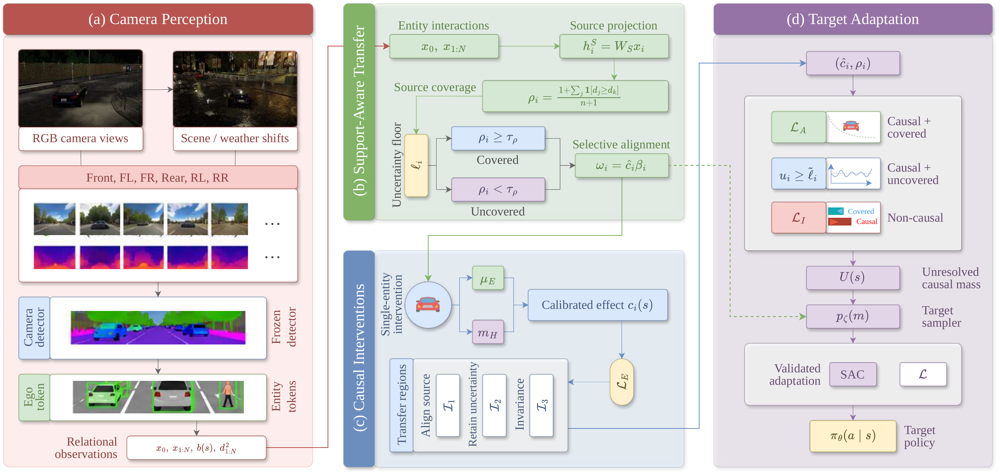
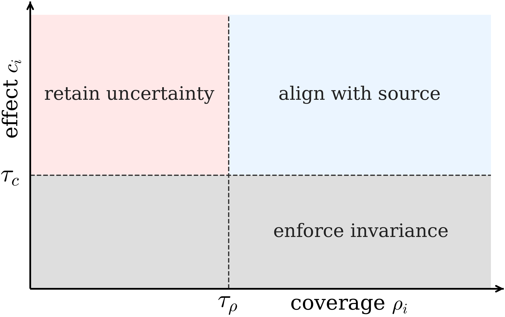
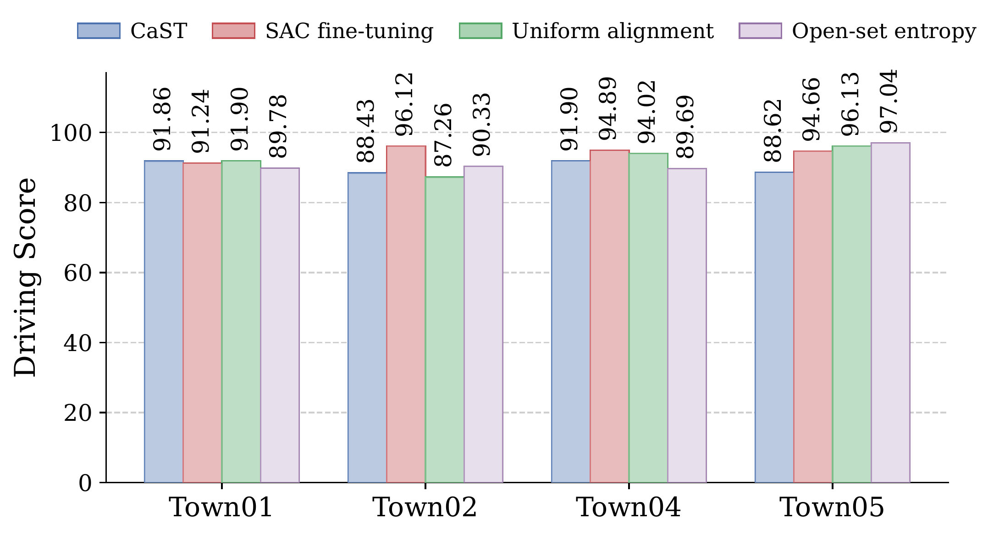
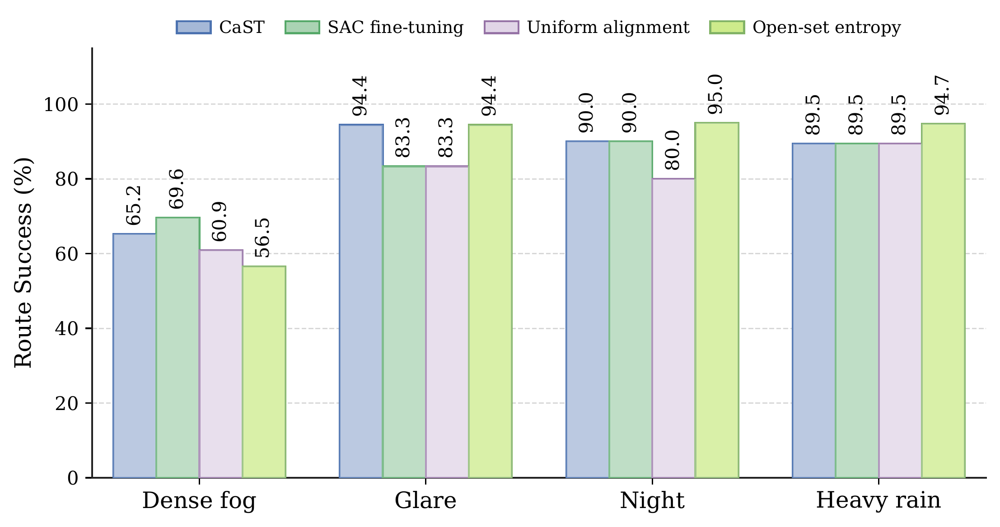
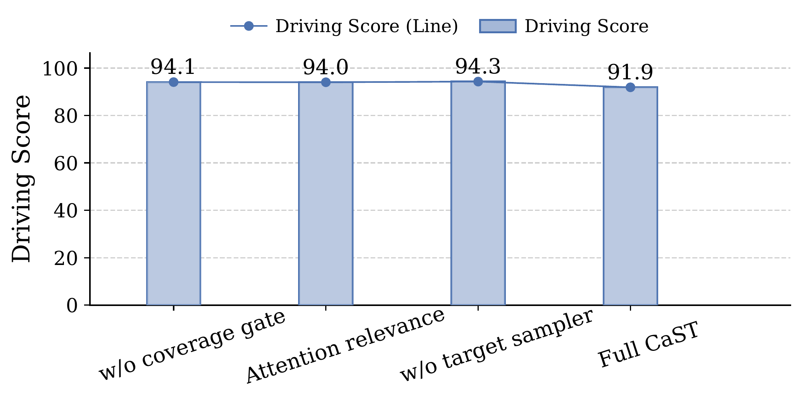
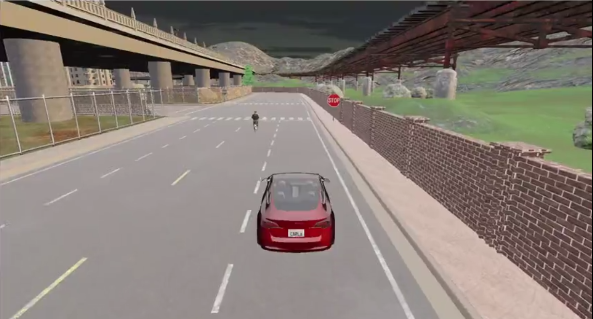
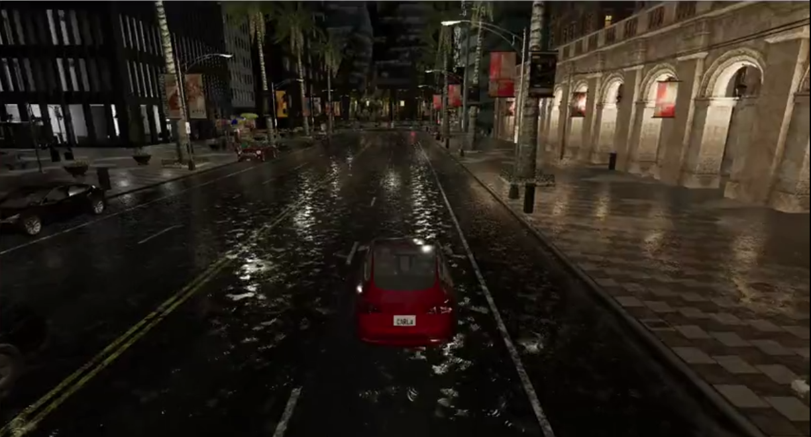

# Transfer What Is Caused and Covered: Policy Transfer for Safe End-to-End Driving

**Causal-Support Transfer (CaST)** · CARLA 0.9.15 · PyTorch · RGB-D · Soft Actor-Critic (SAC)

CaST adapts a driving policy across appearance and road-layout shifts by separating **causal relevance** from **source coverage**. Each interaction is assigned an estimated effect `ĉᵢ` and a support rank `ρᵢ`. The pair determines whether to preserve source behavior, retain uncertainty, or reduce dependence on an irrelevant cue. Target episodes are selected using uncovered causal mass.



## Core idea



| Interaction | Condition | Adaptation behavior |
|:--|:--|:--|
| Causal + covered | `ĉᵢ ≥ τc`, `ρᵢ ≥ τρ` | Source-guided alignment |
| Causal + uncovered | `ĉᵢ ≥ τc`, `ρᵢ < τρ` | Preserve a coverage-dependent uncertainty floor |
| Low causal effect | `ĉᵢ < τc` | Penalize action sensitivity to the interaction |

The released code uses a smooth gate and a separate floor:

```python
beta = (rho / tau_rho - 1.0).clamp(0.0, 1.0)  # alignment gate
ell  = (1.0 - rho / tau_rho).clamp(0.0, 1.0)  # uncertainty floor
omega = causal_score * beta                     # supported causal weight
```

Here `ρ` is a rank of the k-nearest-neighbor distance in the **frozen source embedding space**; it is not a calibrated probability that the policy will succeed.

## Implementation map

The two entry points are [`code/car.py`](code/car.py) (training/adaptation) and [`code/car_eval.py`](code/car_eval.py) (frozen evaluation). Key components in the released implementation:

| Component | Code | Responsibility |
|:--|:--|:--|
| Camera/RGB-D inputs | `CameraRig`, `BEVDetector`, `CaSTCarlaEnv._collect_entity_features` | Ego state, entity tokens, scene descriptor, visibility and uncertainty |
| Interaction encoder | `RelationalEncoder` | Masked attention; `hᵢ = Wθ(xᵢ)`; pooled interaction state |
| Actor + motion | `CaSTActor`, `motion_head` | Bounded stochastic action; relative-motion mean and variance |
| Value learning | `CaSTCritic`, `CaSTAgent.update` | SAC critic ensemble, entropy and source/target imitation |
| Source support | `KNNBank`, `CoverageModel` | Frozen support bank `Zₛ`, rank `ρ`, per-run target-bank growth |
| Causal relevance | `CausalHead`, `CausalDataset`, intervention routines | Predict effects of modifying individual scene entities |
| Transfer | `CaSTAgent.coverage_terms`, `CaSTAgent.ubar`, `CaSTAgent.update` | Selective alignment, uncertainty floor, invariance, conservative values |
| Target sampling | `RunSpec`, target sampler, `run_adaptation` | Select conditions, collect `B` target episodes, resume adaptation |
| Evaluation | `evaluate_town`, `freeze`, `aggregate_main` in `car_eval.py` | Deterministic frozen-policy rollouts and route-level results |

**Forward path**

```text
Six camera views / RGB-D + ego motion
    → object/scene observations (x₀, x₁:N, b, mask)
    → RelationalEncoder → attention wᵢ, embeddings hᵢ
    ├── frozen source projection Wₛ → kNN banks → ρᵢ, ρ₀
    ├── CausalHead → ĉᵢ
    ├── motion head → (μΔp, σ²motion)
    └── actor + critic ensemble → action, value disagreement
                  ↓
    CaST gate βᵢ, floor ℓᵢ, uncertainty ū
                  ↓
    SAC update + selective alignment + invariance
                  ↓
    target scenario sampling; updated adapted policy
```

### Training and evaluation mechanics

- **Source stage:** pretrained perception, source SAC, demonstrations/handovers, causal probes, and source support banks. `SourceArtifacts` stores the frozen artifacts used by adaptation.
- **Target stage:** `run_adaptation` starts from the same source policy, trains CaST and the three baselines using matched `B = 20` target episodes, and saves each run separately.
- **Learning:** `CaSTAgent.update` combines critic/actor updates with optional motion, causal, imitation, alignment and invariance terms. The released B20 configuration uses **squared squashed-action distance** (`--align-metric action`), not the optional Gaussian-KL setting.
- **Uncertainty:** `ubar` combines motion variance, source-support floors and critic disagreement. B20 uses `--uncertainty-fusion mean`; this score is not a calibrated failure probability.
- **Evaluation:** `car_eval.py` loads completed checkpoints, disables gradients, uses deterministic policy actions, and writes resumable per-town route JSONs and aggregated CSVs.

The B20 experiments use `--perception rgbd`, `--light-source v2i`, and `--lateral-control controller`: traffic-light state is assisted and steering is route-guided. These settings should be held fixed for comparisons; they must not be described as fully camera-only, learned-steering evaluations. The code's coverage-bank acceptance also uses adaptation-episode safety checks rather than an independent validation rollout.

## Repository

```text
CaST/
├── code/           car.py, car_eval.py
├── script/         archived seed-0/seed-1 launchers and ablation scripts
├── checkpoints/    CaST agent.pt for A/L/C × seeds 0 and 1 (Git LFS)
├── results/        paper CSVs, audits, town/suite summaries
├── figures/        framework and supplementary diagnostics
├── graphs/         town, weather, safety and ablation plots
├── screenshot/     CARLA driving images
└── video/          driving clips and preview images
```

The `script/` copies are an **experiment inventory**, not self-contained launchers: several expect adjacent helper Python files, seed markers, and a pre-existing CARLA workspace. The six `agent.pt` files also require compatible source/perception artifacts and configuration for full evaluation; those large dependencies are not included here.

## Experiments and results

All reported numbers below use **seed 0**, the **unshielded B20 protocol**, and approximately **200 m held-out routes**. `DS` is driving score; `SR` is successful-route percentage. Larger values are better. The four-town combined-shift set has **80 routes per method** (320 method-route records).

| Method | DS ↑ | SR (%) ↑ | Mean min. TTC (s) ↑ |
|:--|--:|--:|--:|
| SAC fine-tuning | **94.23** | 82.50 | 1.17 |
| Uniform alignment | 92.33 | 77.50 | 1.11 |
| Open-set entropy | 91.71 | **83.75** | 1.17 |
| **CaST (ours)** | 90.20 | **83.75** | **1.22** |

The three-town combined-shift subset overlaps with this four-town set; it is **not an independent replication**. Appearance and layout results and all per-town/per-weather breakdowns are available in [`results/CaST_supplement_snapshot/`](results/CaST_supplement_snapshot/) and [`results/paper_csv/`](results/paper_csv/). A full across-seed estimate is **not** reported; released seed-1 evaluations were incomplete in the archived snapshot. Results do not establish a uniform CaST advantage over the baselines.

### Town and weather analysis

| Town-wise driving score | Mean minimum TTC |
|:--:|:--:|
|  |  |

| Weather-wise driving score | Weather-wise success rate |
|:--:|:--:|
|  |  |

### Ablation and coverage diagnostics

| Driving score | Route success |
|:--:|:--:|
|  |  |

| Reported failure AUROC by coverage-bin index | Town04 ablation: failure AUROC |
|:--:|:--:|
|  |  |

Coverage-bin indices are reproduced as recorded; the archived bin summary does not provide boundaries for interpreting them as ordered support intervals. The Town04 ablation is a single-seed, 20-route-per-variant analysis.

### CARLA samples

| Night / rain | Urban intersection | Night driving |
|:--:|:--:|:--:|
|  |  |  |

### Driving clips

| [](video/1.mp4) | [](video/2.mp4) | [](video/3.mp4) |
|:--:|:--:|:--:|
| [Clip 1](video/1.mp4) | [Clip 2](video/2.mp4) | [Clip 3](video/3.mp4) |

## Usage and reproducibility

**Required:** CARLA **0.9.15**, Python/PyTorch environment compatible with `code/car.py`, and matching frozen source/perception artifacts. The original B20 setup used a source workspace containing `source/source_agent.pt`, `source/source_snapshot.npz`, `source/causal_dataset.npz`, `source/null_bank.pt`, `perception/segnet.pt`, and `run_config.json`.

Inspect the program interfaces before running:

```bash
python code/car.py --help
python code/car_eval.py --help
```

Within the **original complete experiment workspace**, the isolated seed-1 runner uses:

```bash
# From the original cast_b20_s1_3shift_runner directory, not script/ in this archive
SUITES=A,L,C bash run_b20_s1.sh status
SUITES=A bash run_b20_s1.sh eval
SUITES=L EVAL_TOWN=Town01_Opt bash run_b20_s1.sh eval  # repeat for Town04/05
SUITES=C EVAL_TOWN=Town01_Opt bash run_b20_s1.sh eval  # repeat for Town04/05
```

The launchers require configured paths (`PROJECT`, `OLD`, `TRAIN_OUT`, `EVAL_OUT`, `PYTHON`, `CARLA_SH`) and nonconflicting CARLA/Traffic Manager ports. Evaluation should use the same observation and action-interface flags as its checkpoint. Do **not** run the archived shell-script copies directly without restoring their required sidecar files.

For published route-level tables, start with [`results/paper_csv/01_paper_routes_complete.csv`](results/paper_csv/01_paper_routes_complete.csv), [`results/paper_csv/02_main_transfer_A_L_C.csv`](results/paper_csv/02_main_transfer_A_L_C.csv), and [`results/paper_csv/10_result_provenance.csv`](results/paper_csv/10_result_provenance.csv). Some historical CSVs are empty or exploratory; use the audit/provenance files to establish what each table supports.

**Scope.** Training seeds share the frozen source/perception backbone. Neither route samples nor steps are independent training seeds. The supplied archive supports descriptive driving-performance comparisons, not a claim of three-seed significance or independently validated causal-effect accuracy.
